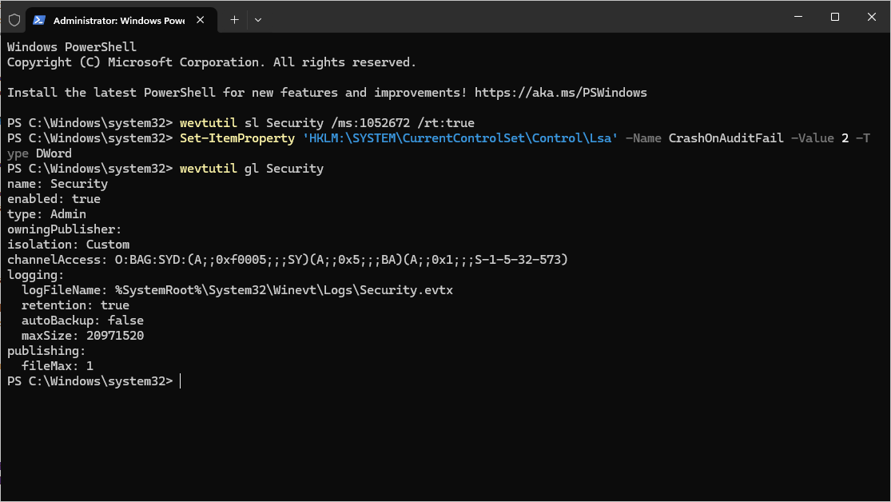
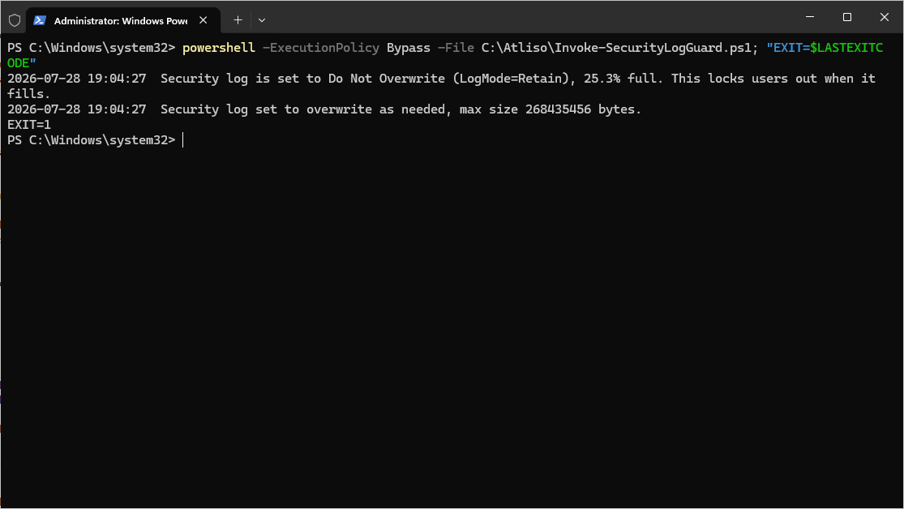
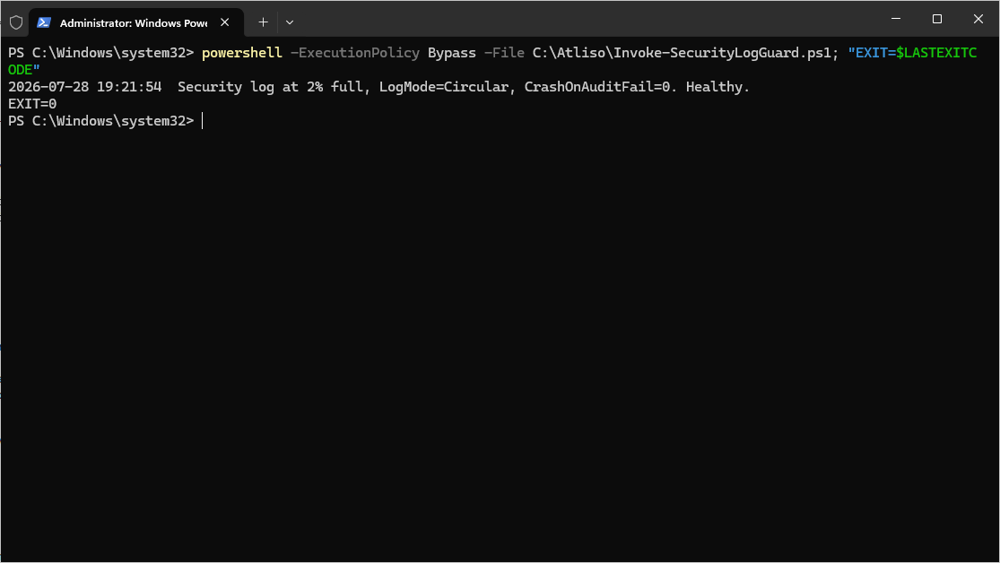

# Security Log Guard

PowerShell script that catches the Windows Security log lockout before it locks your users out, and fixes it when it has already tripped.

When the Security event log is set to Do Not Overwrite and fills up, Windows can flip `CrashOnAuditFail` to 2. At that point only administrators can log on, and everyone else is locked out until the log is cleared. This script spots the risky state early and repairs it.

## What it does

- Reads the Security log mode, size, and percent full
- Flags the root cause: a log set to Do Not Overwrite (LogMode Retain) that will halt logons when it fills
- Detects the lockout after it has tripped by reading `CrashOnAuditFail`
- Archives and clears the log, resets `CrashOnAuditFail` from 2 back to 1, and sets the log to overwrite at a sane size so it cannot happen again
- Reports only by default. Nothing changes until you set `-WhatIf $false`
- Logs every action to `%LOCALAPPDATA%\Atliso\SecurityLogGuard.log`

## Quick start

1. Download [`Atliso-SecurityLogGuard.ps1`](Atliso-SecurityLogGuard.ps1)
2. Open the top of the script and set the config for your environment:

```powershell
$WarnThresholdPercent = 90       # remediate once the log is this full
$TargetMaxSizeBytes   = 256MB    # size to set the Security log to
$WhatIf               = $true    # $false to actually apply the fix
```

3. Run it to audit, then set `$WhatIf` to `$false` to remediate.

## Deploy in Intune

Deploy it as a Remediation so every device is checked on a schedule.

1. In the Intune admin center: **Devices > Scripts and remediations > Remediations** > Create.
2. Use the detection half (exits 1 when the log is on Do Not Overwrite, over the threshold, full, or the lockout has tripped) as the detection script.
3. Use this script with `-WhatIf $false` as the remediation script.
4. Run as **SYSTEM**, **64-bit**.

## What it looks like

The config that causes the lockout:



Detection flagging the device:



After remediation, the log set to overwrite and the lockout cleared:



## Requirements

- Windows 10 or 11
- PowerShell 5.1 or later
- Rights to write to the Lsa key and manage the Security log (runs as SYSTEM under Intune)

## Full guide

Step by step, with screenshots: https://atliso.com/blog/windows-11-security-log-full-lockout-fix

## License

MIT. Free to use, change, and ship. See [LICENSE](LICENSE).
